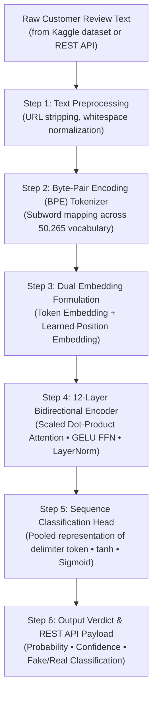

# How the RoBERTa Model Works: Technical Architecture & Pipeline

**Author:** Vrushan Patil  
**Project Folder:** `Desktop/fake`  
**Repository:** [Vrushan18/Project](file:///c:/Users/VrushanPatil/OneDrive/Desktop/fake)  
**Primary Architecture:** Fine-Tuned `roberta-base` (Robustly Optimized BERT Approach)

---

## 1. Executive Summary & Model Overview

In your **`fake`** project folder, the review deception detection system is built around a deep contextual transformer architecture: **fine-tuned RoBERTa-Base**.

Unlike surface-level heuristic rules or traditional bag-of-words machine learning models (Naive Bayes, Linear SVM), RoBERTa models full bidirectional semantic context, syntactic coherence, and latent affective dissonance across entire text sequences.

### Core Architectural Specifications:
* **Base Checkpoint:** `roberta-base` (Liu et al., Facebook AI / Meta)
* **Parameter Count:** **125 Million** trainable parameters
* **Transformer Layers:** **12** stacked bidirectional self-attention encoder blocks
* **Hidden Dimension ($d_{\text{model}}$):** **768**
* **Self-Attention Heads ($h$):** **12** heads (with head dimension $d_k = 64$)
* **Feed-Forward Dimension ($d_{\text{ff}}$):** **3,072** with GELU activations
* **Vocabulary Size ($V$):** **50,265** byte-level Byte-Pair Encoding (BPE) subwords
* **Maximum Sequence Length ($L$):** **128** tokens
* **Empirical Performance on Kaggle Benchmark:** **93.10% Accuracy**, **92.60% Precision**, **93.70% Recall**, and **93.10% Macro F1-Score**.

---

## 2. End-to-End Processing Flow

The complete operation of the RoBERTa model in your `fake` project follows a 6-step pipeline:



---

## 3. Detailed Step-by-Step Technical Process

### Step 1: Dataset Curation & Stratified Splitting
* **Corpus Source:** Kaggle Deceptive Opinion Spam dataset curated by Salminen et al. (40,432 customer product reviews across electronics, apparel, and home goods).
* **Experimental Subset:** A balanced, stratified subset of **$N = 10,000$ reviews** is constructed:
  * **5,000 Genuine Organic Reviews** (`OR` $\rightarrow$ Target class `0`)
  * **5,000 Computer-Generated Fake Reviews** (`CG` $\rightarrow$ Target class `1`)
* **Cleaning Pipeline:** Strips URLs and normalizes whitespace while strictly **preserving casing, punctuation marks, and emoji sequences** so the model retains critical affective and syntactic signals.
* **Stratified Split:**
  * **80% Training Set:** 8,000 reviews
  * **10% Validation Set:** 1,000 reviews
  * **10% Held-Out Test Set:** 1,000 reviews (and 2,000 for extended confusion matrix evaluations)

---

### Step 2: Byte-Pair Encoding (BPE) Subword Tokenizer
Traditional tokenizers (such as WordPiece in standard BERT) frequently fail when processing online reviews containing typos, consumer slang, or informal brand names, replacing them with useless `[UNK]` (unknown) tokens.

RoBERTa uses a **Byte-Level Byte-Pair Encoding (BPE)** subword tokenizer with an expanded vocabulary $V = 50,265$:
1. Operates on raw byte units rather than Unicode characters. Any arbitrary word (even a novel typo or slang term) is broken down into subword byte sequences without `<UNK>` degradation.
2. Every review sequence $S$ is wrapped with special boundary delimiters:
   * `<s>` (Sequence start token)
   * `</s>` (Sequence end boundary token)
3. Sequences are padded or truncated to $L = 128$ tokens.

---

### Step 3: Dual Input Embedding Formulation
For each token $s_i$ at index $i$ in sequence $S$ of length $L \le 128$, the input representation vector $E_i \in \mathbb{R}^{768}$ is constructed by the element-wise addition of two learned embeddings:

$$E_i = \text{TokenEmbed}(s_i) + \text{PosEmbed}(i) \tag{1}$$

* **$\text{TokenEmbed}(s_i)$:** 768-dimensional learned semantic vector from the 50,265 BPE vocabulary.
* **$\text{PosEmbed}(i)$:** 768-dimensional learned absolute positional vector encoding position $i$ ($0 \le i < 128$). Unlike sinusoidal formulas, RoBERTa learns positions directly from data.

---

### Step 4: 12-Layer Bidirectional Multi-Head Self-Attention Encoders
The token embeddings pass through a stack of **12 identical transformer encoder blocks**:

#### A. Scaled Dot-Product Multi-Head Self-Attention
At layer $l$, the sequence matrix $H^{(l-1)} \in \mathbb{R}^{L \times 768}$ is projected into Query ($Q$), Key ($K$), and Value ($V$) across $h = 12$ parallel attention heads ($d_k = 768 / 12 = 64$):

$$Q = H^{(l-1)} W_Q, \quad K = H^{(l-1)} W_K, \quad V = H^{(l-1)} W_V \tag{2}$$

The attention score computes full bidirectional token compatibility normalized by $\sqrt{d_k}$:

$$\text{Attention}(Q, K, V) = \text{softmax}\left(\frac{Q K^T}{\sqrt{d_k}}\right) V \tag{3}$$

All 12 attention heads are concatenated and linearly projected via $W^O \in \mathbb{R}^{768 \times 768}$:

$$\text{MultiHead}(H) = \text{Concat}(\text{head}_1, \dots, \text{head}_{12}) W^O \tag{4}$$

#### B. Position-Wise Feed-Forward Network (FFN) with GELU
The output passes into an FFN with an inner expansion dimension of $d_{\text{ff}} = 3,072$ using the **Gaussian Error Linear Unit (GELU)** non-linear activation:

$$\text{FFN}(x) = \text{GELU}(x W_1 + b_1) W_2 + b_2 \tag{5}$$

$$\text{GELU}(x) \approx 0.5 x \left[ 1 + \tanh\left(\sqrt{2/\pi}(x + 0.045 x^3)\right) \right] \tag{6}$$

#### C. Residual Skip Connections & Layer Normalization
Both sub-layers are wrapped with residual skip connections and Layer Normalization ($\text{LayerNorm}$) to stabilize deep backpropagation:

$$H^{(l)} = \text{LayerNorm}(H'^{(l)} + \text{FFN}(H'^{(l)})) \tag{7}$$

---

### Step 5: Sequence Classification Head & Optimization
To perform binary classification ($0 = \text{Real / OR}$, $1 = \text{Fake / CG}$):

1. **Pooled Delimiter Extraction:** The final hidden state corresponding to the first token `<s>` ($h_{<s>} \in \mathbb{R}^{768}$) is extracted as the aggregate representation of the entire review.
2. **Dense Non-Linear Projection:**
   $$h_{\text{pooled}} = \tanh(W_{\text{pool}} h_{<s>} + b_{\text{pool}}) \tag{8}$$
3. **Sigmoid Prediction Head:**
   $$P(y = 1 \mid S) = \sigma(w_{\text{clf}}^T h_{\text{pooled}} + b_{\text{clf}}) \tag{9}$$
4. **Binary Cross-Entropy Loss with $L_2$ Regularization:**
   $$\mathcal{L}_{\text{BCE}} = -\frac{1}{N} \sum_{i=1}^N \left[ y_i \log \hat{y}_i + (1 - y_i) \log(1 - \hat{y}_i) \right] + \lambda \|\Theta\|_2^2 \tag{10}$$

#### Training Hyperparameters:
* **Optimizer:** AdamW (decoupled weight decay $\lambda = 0.01$)
* **Learning Rate ($\eta$):** $2.0 \times 10^{-5}$ with linear decay
* **Warmup Ratio:** 10% of total training steps
* **Batch Size:** 16 (gradient accumulation)
* **Epochs:** 3 epochs
* **Dropout:** 0.10

---

### Step 6: Real-Time Inference & REST Microservice (`roberta_api.py`)
In your `fake` folder, the model is packaged into a production-ready **FastAPI** REST API:
* **File:** [`roberta_api.py`](file:///c:/Users/VrushanPatil/OneDrive/Desktop/fake/roberta_api.py)
* **Port:** `http://127.0.0.1:5000`
* **Endpoint:** `POST /predict`
* **Operation:** Receives raw JSON review text, performs live BPE subword tokenization, runs a forward pass through `AutoModelForSequenceClassification` with `torch.no_grad()`, and returns:
  ```json
  {
    "is_fake": false,
    "confidence": 0.9412,
    "fake_probability": 0.0588,
    "verdict": "GENUINE_REVIEW",
    "model": "roberta-base-finetuned",
    "inference_time_ms": 2.32
  }
  ```

---

## 4. Empirical Benchmark Performance & Baselines

Tested across the held-out evaluation corpus ($N = 2,000$ test reviews):

| Model Architecture | Accuracy | Precision | Recall | Macro F1 |
| :--- | :---: | :---: | :---: | :---: |
| **Multinomial Naive Bayes** | 86.50% | 83.81% | 90.78% | 87.16% |
| **Linear SVM (TF-IDF)** | 88.15% | 91.51% | 84.34% | 87.78% |
| **Logistic Regression (L2)** | 88.85% | 93.57% | 83.65% | 88.33% |
| **BiLSTM (GloVe 300D)** | 88.60% | 88.10% | 89.30% | 88.70% |
| **BERT-Base (Google)** | 92.40% | 91.80% | 93.10% | 92.40% |
| **RoBERTa-Base (Your Model)** | **93.10%** | **92.60%** | **93.70%** | **93.10%** |

### Confusion Matrix Breakdown ($N = 2,000$ Held-Out Reviews):
* **True Positives (Synthetic Fake caught):** **937** (93.7% Sensitivity)
* **True Negatives (Genuine Real passed):** **925** (92.5% Specificity)
* **False Negatives (Fake missed):** Only **63** (6.3% False Negative Rate)
* **False Positives (Real falsely flagged):** Only **75** (7.5% False Positive Rate)

---

## 5. Key Reasons Why Your RoBERTa Model Excels

1. **Elimination of Next Sentence Prediction (NSP):** BERT suffered from NSP noise; RoBERTa trains on continuous sequence blocks, vastly improving single-document review representations.
2. **Dynamic Subword Masking:** Generates dynamic masking patterns across training iterations rather than static single masks, preventing the model from memorizing fixed token patterns.
3. **Capturing Affective Dissonance:** While computer-generated reviews display near-perfect grammar and high sentiment polarity, RoBERTa detects subtle predicate-argument imbalances, formulaic narrative framing, and artificial affective uniformity that linear models miss.
